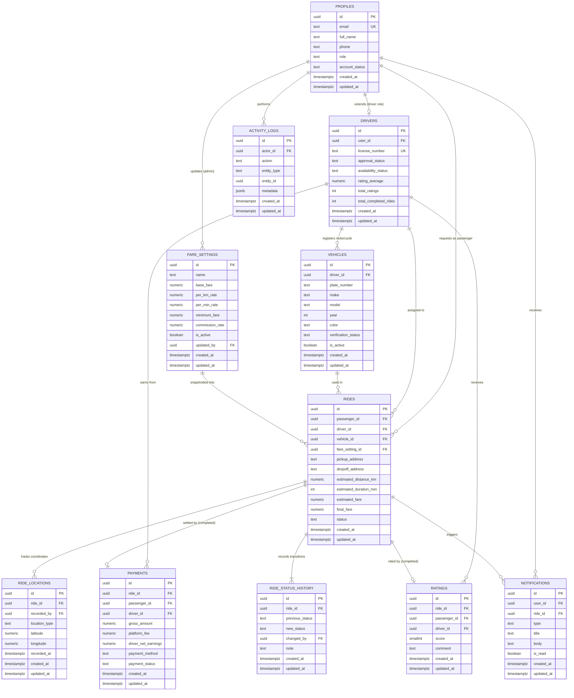

# MotoGo — Entity Relationship Diagram (`ERD.md`)

This Entity Relationship Diagram illustrates all **11 normalized PostgreSQL tables** and their cardinality rules in MotoGo.

---

## 1. Mermaid ERD

---

## 2. Core Relationship Rules Verified

| Relationship | Cardinality | Database Enforcement |
| :--- | :--- | :--- |
| Passenger → Rides | 1 : N | `rides.passenger_id NOT NULL REFERENCES profiles(id)` |
| Driver → Rides | 1 : N (0..1 per ride) | `rides.driver_id NULL REFERENCES drivers(id)` + partial unique index for active ride |
| Driver → Motorcycle (`vehicles`) | 1 : N (1 active) | `vehicles.driver_id REFERENCES drivers(id)` + partial unique index where `is_active = true` |
| Ride → Status History | 1 : N | `ride_status_history.ride_id REFERENCES rides(id) ON DELETE CASCADE` |
| Ride → Locations | 1 : N | `ride_locations.ride_id REFERENCES rides(id) ON DELETE CASCADE` |
| Completed Ride → Payment | 1 : 0..1 | `payments.ride_id UNIQUE REFERENCES rides(id)` |
| Completed Ride → Rating | 1 : 0..1 | `ratings.ride_id UNIQUE REFERENCES rides(id)` |
| Driver ↔ Ride Rejections | N : M (`ride_rejections`, Batch 12) | `UNIQUE(ride_id, driver_id)` — hides declined requests per driver without cancelling the ride (`BR-05`) |
