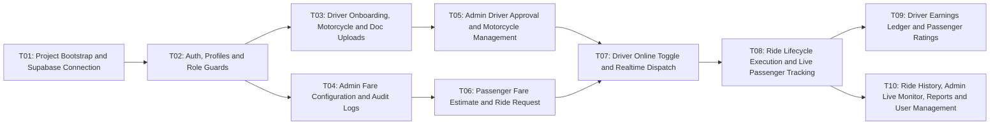

# MotoGo — Implementation Plan (`IMPLEMENTATION_PLAN.md`)

> **Skills Applied:** Structured using Matt Pocock's `to-tickets` **tracer-bullet vertical slice** methodology. Every ticket cuts a narrow, verifiable, end-to-end slice through database/RLS, server logic, UI, and tests—and declares its exact **Blocked by** dependencies.

---

## 1. Dependency Graph (Build Frontier)

---

## 2. Tracer-Bullet Vertical Slices (Tickets)

### Ticket 01: Project Bootstrap & Online Supabase Connection
- **Blocked by:** None (can start immediately in Batch 3)
- **What it delivers:** Initializes Git (with `.gitignore` protecting `.env.local`), scaffolds the Next.js App Router + React + TypeScript + Tailwind CSS app safely without overwriting `.agents/`, `skills-lock.json`, or Batch 1–2 docs, installs `@supabase/supabase-js` and `@supabase/ssr`, configures `.env.local` for `https://euiifsblmwuwquershku.supabase.co`, and adds a health-check route confirming live Supabase connectivity.
- **Acceptance Criteria:**
  - [ ] `npm run build` and `npm run lint` pass cleanly with `strict: true` TypeScript.
  - [ ] Existing `.agents/skills/` (39 skills) and Batch 1–2 markdown documents remain completely intact.
  - [ ] Browser, Server, and Middleware Supabase clients are configured and verified against the online project.

---

### Ticket 02: Authentication, User Profiles & Role-Based Route Guards
- **Blocked by:** `T01`
- **What it delivers:** Creates the `profiles` table + RLS policies + auth trigger, implements `/register` (Passenger or Driver only — never Admin), `/login`, logout, and Next.js middleware routing users to `/passenger`, `/driver`, or `/admin` while enforcing `account_status` (`active` vs. `suspended`).
- **Acceptance Criteria:**
  - [ ] Passengers and Drivers can register, log in, and land on their respective dashboards.
  - [ ] Unauthenticated users are redirected to `/login`; cross-role navigation is blocked.
  - [ ] Suspended users cannot access booking or dispatch actions.
  - [ ] RLS prevents users from reading or modifying other users' profiles.

---

### Ticket 03: Driver Onboarding, Motorcycle Details & Private Document Uploads
- **Blocked by:** `T02`
- **What it delivers:** Creates `drivers`, `motorcycles`, and `driver_documents` tables + private Supabase Storage bucket `driver-documents` with strict RLS/Storage policies; builds the Driver onboarding form (motorcycle plate/make/model/year/color + document uploads) and approval status screen (`pending` / `rejected` with resubmission).
- **Acceptance Criteria:**
  - [ ] A registered Driver can submit unique motorcycle details and upload valid image/PDF verification documents (size/type validated).
  - [ ] Unapproved Drivers see their approval status and are blocked from going online (`BR-01`).
  - [ ] Document files are stored privately and cannot be accessed via public URLs.

---

### Ticket 04: Admin Fare Configuration & Activity Logging Foundation
- **Blocked by:** `T02`
- **What it delivers:** Creates `fare_configs` and append-only `activity_logs` tables + RLS policies, seeds a default active Fare Configuration, implements the pure Fare Engine unit-tested module, and builds `/admin/fares` and `/admin/logs`.
- **Acceptance Criteria:**
  - [ ] Unit tests verify `fare = max(minimum_fare, base + km * per_km + min * per_min)` and commission math (`BR-08`, `BR-09`).
  - [ ] Admin can update active fare parameters; every change writes an immutable `activity_logs` row (`BR-14`).
  - [ ] Non-admins are blocked by both Server Action and RLS from modifying fares or reading logs.

---

### Ticket 05: Admin Driver Approval & Motorcycle Management
- **Blocked by:** `T03`, `T04`
- **What it delivers:** Builds `/admin/drivers` (pending application queue, short-lived signed URL document viewer, Approve / Reject with mandatory reason) and `/admin/motorcycles` (verify/deactivate vehicles), recording every action in `activity_logs`.
- **Acceptance Criteria:**
  - [ ] Admin can view driver documents via temporary signed URLs.
  - [ ] Approving a driver unlocks their ability to go online; rejecting requires a non-empty reason (`BR-13`) and surfaces it to the driver.
  - [ ] Deactivating a motorcycle prevents its driver from going online (`BR-01`).

---

### Ticket 06: Passenger Fare Estimate & Ride Request
- **Blocked by:** `T04`
- **What it delivers:** Creates the `rides` table + RLS policies, builds the mobile-first `/passenger` booking flow (select pickup & destination, calculate upfront fare estimate, submit ride request with locked Fare Snapshot, cancel before pickup).
- **Acceptance Criteria:**
  - [ ] Pickup and destination cannot be identical (`BR-15`).
  - [ ] Passenger cannot create a second active ride while one is in progress (`BR-02`).
  - [ ] Updating global fare rules after booking does not alter the ride's snapshotted fare (`BR-07`).

---

### Ticket 07: Driver Online Toggle & Realtime Ride Dispatch (Atomic Accept/Reject)
- **Blocked by:** `T05`, `T06`
- **What it delivers:** Adds Driver `online`/`offline` toggle, Supabase Realtime subscription for incoming `requested` rides, per-driver rejection tracking (`ride_rejections`), and a PostgreSQL RPC (`accept_ride`) for atomic, race-free ride acceptance.
- **Acceptance Criteria:**
  - [ ] Only approved drivers with an active motorcycle can go `online` (`BR-01`).
  - [ ] New passenger ride requests appear on online drivers' screens in real time (≤ 2s).
  - [ ] Rejecting a ride hides it only for that driver (`BR-05`).
  - [ ] Simultaneous accepts from two drivers allow exactly one winner and cleanly notify the other (`BR-04`).

---

### Ticket 08: Ride Lifecycle Execution & Live Passenger Tracking
- **Blocked by:** `T07`
- **What it delivers:** Implements sequential driver ride controls (`accepted` → `driver_arrived` → `in_progress` → `completed`, plus pre-pickup cancellation) backed by a validated state-transition RPC, and updates the Passenger's live screen in real time with assigned driver & motorcycle info.
- **Acceptance Criteria:**
  - [ ] Out-of-order state jumps (e.g., `accepted` → `completed`) are rejected at the database layer (`BR-06`).
  - [ ] Passenger sees driver name, rating, phone, motorcycle details, and live status transitions without refreshing.
  - [ ] Driver returns to `online` automatically when a ride completes or is cancelled before pickup.

---

### Ticket 09: Driver Earnings Ledger & Passenger Ratings
- **Blocked by:** `T08`
- **What it delivers:** Creates `driver_earnings` and `ratings` tables + automatic earnings ledger creation upon ride completion + Passenger 1–5 star rating modal + Driver `/driver/earnings` dashboard (today, week, total, and per-ride breakdown).
- **Acceptance Criteria:**
  - [ ] Completing a ride creates exactly one earnings entry (`net = final_fare - platform_fee`); cancelled rides create none (`BR-09`).
  - [ ] Passenger can rate the assigned driver once per completed ride (`BR-10`), updating the driver's average rating.

---

### Ticket 10: Ride History, Admin Live Monitor, Reports & User Management
- **Blocked by:** `T08`, `T09`
- **What it delivers:** Completes Passenger `/passenger/history`, Admin `/admin/users` (search/suspend/reactivate), Admin `/admin/rides` (live Realtime monitor + audited emergency cancellation), and Admin `/admin/reports` (KPI cards + date-range operational/financial summaries).
- **Acceptance Criteria:**
  - [ ] Passengers see paginated history of their own rides.
  - [ ] Admins can suspend/reactivate accounts, monitor live rides in real time, perform audited cancellations, and view accurate revenue/completion reports.

---

## 3. Recommended Batch Mapping

- **Batch 3:** `T01` (Bootstrap + Supabase Connection) & `T02` (Auth + Profiles + Role Guards)
- **Batch 4:** `T03` (Driver Onboarding + Storage) & `T04` (Fare Engine + Audit Logs) & `T05` (Admin Driver/Motorcycle Approvals)
- **Batch 5:** `T06` (Passenger Booking) & `T07` (Realtime Dispatch + Atomic Accept) & `T08` (Ride Lifecycle + Live Tracking)
- **Batch 6:** `T09` (Earnings + Ratings) & `T10` (History + Admin Monitor, Reports & User Management)
