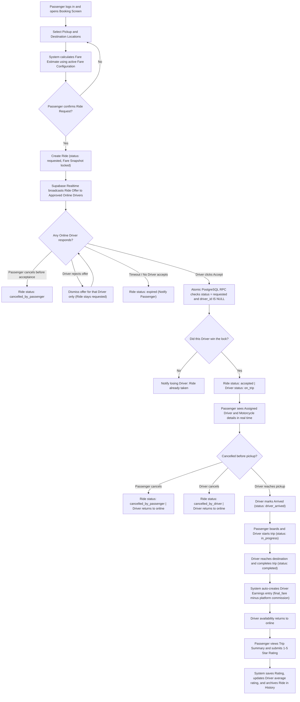
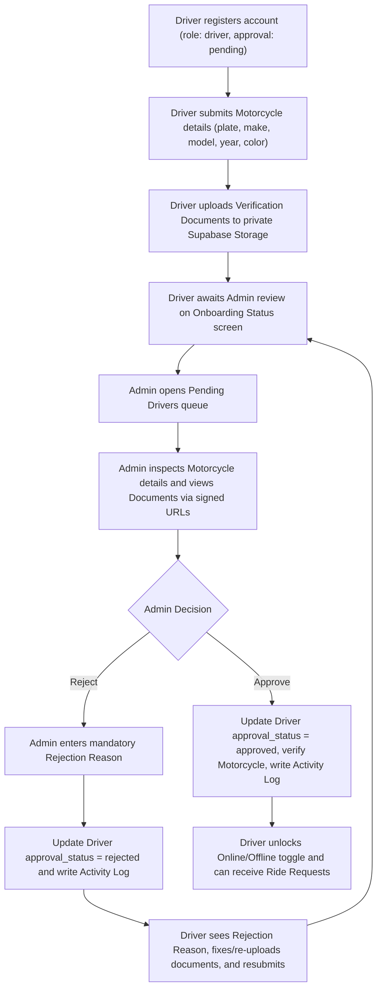

# MotoGo — User Workflows (`USER_WORKFLOWS.md`)

This document maps the core end-to-end user journeys in MotoGo, including the complete **Passenger-to-Driver Ride Process** and **Driver Onboarding & Approval**.

---

## 1. Complete Passenger-to-Driver Ride Workflow (Mermaid)

---

## 2. Driver Onboarding & Admin Approval Workflow (Mermaid)

---

## 3. Step-by-Step Walkthroughs

### 3.1 Passenger Ride Journey
1. **Sign In & Setup:** Passenger signs in and lands on `/passenger`. If they already have an active ride, MotoGo automatically resumes their live ride tracker (`BR-02`).
2. **Route & Fare Preview:** Passenger picks pickup and destination points. MotoGo computes distance, estimated duration, and upfront fare using the active Fare Configuration (`BR-08`).
3. **Request & Matching:** Clicking **Request Ride** locks the fare snapshot (`BR-07`) and broadcasts the ride in real time. Passenger sees a "Finding nearby driver..." state with a **Cancel** option.
4. **Live Tracking:** Once a driver accepts, Passenger immediately sees the driver's name, rating, phone number, and motorcycle plate/model/color, plus live status updates (`accepted` → `driver_arrived` → `in_progress` → `completed`).
5. **Completion & Rating:** Upon completion, Passenger sees the final fare summary and can submit a one-time 1–5 star rating and comment (`BR-10`). The trip is saved in **Ride History**.

### 3.2 Driver Daily Shift Journey
1. **Approval Check:** Unapproved drivers see only their onboarding checklist and approval status (`BR-01`).
2. **Going Online:** Approved drivers with an active motorcycle toggle **Go Online** on `/driver`.
3. **Receiving & Accepting Rides:** Incoming `requested` rides appear in real time. Rejecting hides the request only for that driver (`BR-05`). Accepting triggers the atomic PostgreSQL RPC (`BR-04`); if successful, the driver enters `on_trip` mode (`BR-03`).
4. **Executing the Trip:** Driver taps **Mark Arrived** (`driver_arrived`) → **Start Ride** (`in_progress`) → **Complete Ride** (`completed`).
5. **Earnings:** Completing the ride automatically credits the driver's earnings ledger (`final_fare - platform_commission`) and returns the driver to `online` (`BR-09`).

### 3.3 Administrator Governance Journey
1. **Driver Vetting:** Admin reviews pending drivers, opens private verification documents via short-lived signed URLs, and approves or rejects with a reason (`BR-13`).
2. **Operations Monitoring:** Admin monitors live rides on `/admin/rides`, manages users and motorcycles, and can intervene on stuck rides with an audited cancellation.
3. **Pricing & Reporting:** Admin updates Fare Configuration (affecting only *future* rides per `BR-07`), reviews KPI/revenue reports, and inspects immutable `activity_logs` (`BR-14`).
